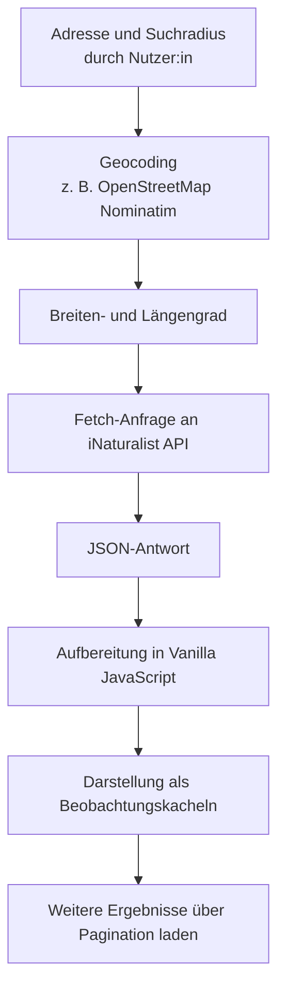
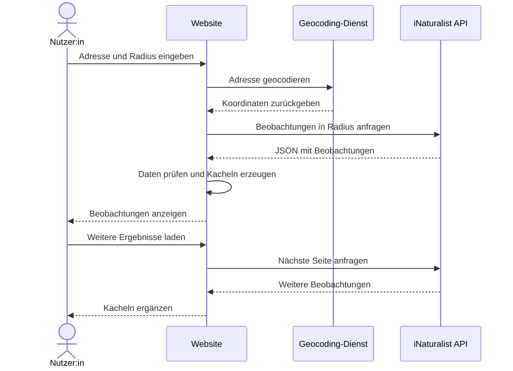
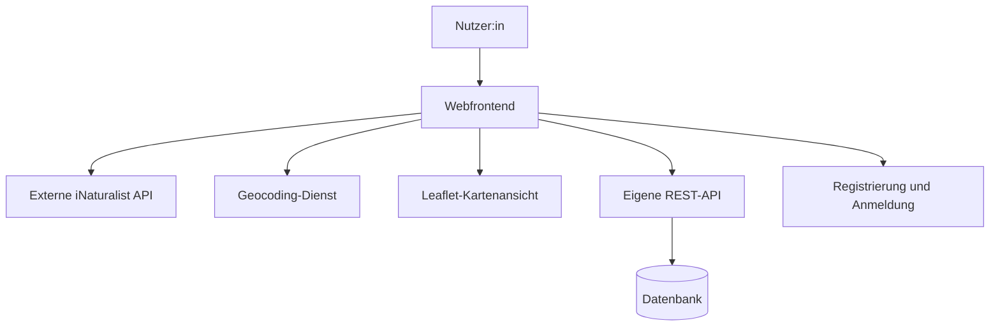

# NATURELY -- Naturbeobachtungen in deiner Umgebung

> **Die Natur beginnt direkt vor deiner Haustür.**\
> Entdecke Tiere, Pflanzen und andere faszinierende Naturbeobachtungen
> in deiner Umgebung.

Diese README beschreibt die Idee, Zielgruppe, Datenquelle, Anforderungen
und das visuelle Grundkonzept des Uni-Projekts. Sie dient als initiale
Projekt- und Designgrundlage. Die Umsetzung des ersten Meilensteins
erfolgt zunächst ohne JavaScript-Frameworks und ohne externe
JavaScript-Bibliotheken.

------------------------------------------------------------------------

## 1. Projektidee

NATURELY ist eine Webplattform, mit der Nutzer:innen Naturbeobachtungen
in ihrer Umgebung entdecken können. Dazu gehören beispielsweise Vögel,
Insekten, Pflanzen, Pilze und andere Tier- und Pflanzenarten.

Nutzer:innen geben einen Standort -- zunächst über eine Adresse -- sowie
einen gewünschten Suchradius ein. Die Anwendung ruft passende
Naturbeobachtungen über eine externe REST-API ab und stellt sie
übersichtlich auf der Hauptseite dar. Perspektivisch sollen die
Beobachtungen zusätzlich auf einer interaktiven Karte erkundet und
eigene Sichtungen eingetragen werden können.

**Ziel:** Die lokale Biodiversität sichtbar machen und einen
niedrigschwelligen Zugang zur Naturbeobachtung schaffen.

## 2. Zielgruppe

Die Plattform richtet sich insbesondere an:

-   **Naturinteressierte:** Menschen, die mehr über Tiere und Pflanzen
    in ihrer Umgebung erfahren möchten.
-   **Hobby-Naturbeobachter:innen:** Personen, die regelmäßig draußen
    unterwegs sind und neue Beobachtungsorte entdecken möchten.
-   **Schüler:innen und Studierende:** Menschen, die sich mit
    Biodiversität, Artenvielfalt und Umweltschutz beschäftigen.
-   **Gelegenheitsnutzer:innen:** Personen, die spontan herausfinden
    möchten, welche Arten in ihrer unmittelbaren Umgebung vorkommen.

Die Anwendung soll einfach und intuitiv bedienbar sein. Fachwissen über
Artenbestimmung soll keine Voraussetzung darstellen.

## 3. Datenquelle und externe Dienste

### iNaturalist API v2

Als Datenquelle wird die [iNaturalist API
v2](https://api.inaturalist.org/v2/docs/) verwendet. iNaturalist stellt
eine umfangreiche Sammlung von Naturbeobachtungen bereit, die von einer
internationalen Community dokumentiert werden.

Je nach Datensatz können unter anderem folgende Informationen abgerufen
werden:

-   Name und wissenschaftliche Bezeichnung der beobachteten Art
-   Foto(s) der Beobachtung
-   Zeitpunkt der Beobachtung
-   Geografischer Standort
-   Informationen zur Artengruppe und zur Bestimmungsqualität

Für die Anwendung ist insbesondere der Beobachtungs-Endpunkt relevant.
Über geografische Koordinaten und einen Suchradius können passende
Beobachtungen gesucht werden. Die API unterstützt eine serverseitige
Paginierung, unter anderem über die Parameter `page` und `per_page`.

**Nützliche Links:** - [iNaturalist API --
Dokumentation](https://api.inaturalist.org/v2/docs/) - [iNaturalist --
Website](https://www.inaturalist.org/) - [iNaturalist -- API-Hinweise
und
Nutzungsinformationen](https://www.inaturalist.org/pages/api+recommended+practices)

### Adresssuche und Geocoding

Die iNaturalist-Suche benötigt geografische Koordinaten (Breiten- und
Längengrad). Eine eingegebene Adresse muss daher zunächst in Koordinaten
umgewandelt werden. Dafür kann beispielsweise der Geocoding-Dienst
[OpenStreetMap
Nominatim](https://nominatim.org/release-docs/latest/api/Search/)
eingesetzt werden.

Geplanter Ablauf:

1.  Nutzer:in gibt eine Adresse oder einen Ort ein.
2.  Die Anwendung fragt den Geocoding-Dienst nach passenden Koordinaten.
3.  Die Koordinaten werden zusammen mit dem Suchradius an iNaturalist
    übergeben.
4.  Die zurückgegebenen Beobachtungen werden auf der Hauptseite
    angezeigt.

**Wichtig:** Nominatim hat eine eigene Usage Policy und
Nutzungsbeschränkungen. Diese müssen vor der Integration berücksichtigt
werden. Für produktiven oder stark frequentierten Betrieb sollte die
Wahl des Geocoding-Dienstes erneut geprüft werden.

### Datenfluss



## 4. Anforderungen

### 4.1 Vorgegebene Mindestanforderungen der Gesamtanwendung

-   Die Website stellt Inhalte übersichtlich auf mehreren Unterseiten
    dar.
-   Nutzer:innen können sich über Formulare registrieren und anmelden.
-   Daten werden über eine externe REST-API dynamisch abgerufen und
    dargestellt.
-   Ein Teil dieser Daten wird mithilfe der Bibliothek Leaflet auf einer
    interaktiven Karte dargestellt.
-   Nutzer:innen können eigene Datensätze hinzufügen.
-   Diese eigenen Datensätze werden über eine selbst implementierte
    REST-API in einer Datenbank gespeichert.

### 4.2 Umfang des ersten Meilensteins

Für den ersten Meilenstein sind folgende Bestandteile vorgesehen:

-   Entwicklung eines Designkonzepts und Umsetzung des CSS.
-   Statische Unterseiten für Login, Registrierung,
    Datenschutzerklärung, Kontakt und Impressum. Die Formulare und
    Seiten sind zunächst noch nicht funktional.
-   Eine Hauptseite, die Inhalte mithilfe der nativen Fetch-API
    asynchron von einer externen REST-API abruft.
-   Darstellung der abgerufenen Inhalte in einer übersichtlichen
    Kachelansicht.
-   Begrenzte Anzahl sichtbarer Ergebnisse und Nachladen weiterer
    Elemente über Pagination.
-   Behandlung von Fehlerfällen, beispielsweise bei Nichterreichbarkeit
    der API oder fehlerhaften Antworten.
-   Verwendung von Vanilla JavaScript: keine Frameworks und keine
    externen JavaScript-Bibliotheken für den API-Abruf und die
    Darstellung.

**Abgrenzung:** Registrierung, Anmeldung, eigene Datensätze, Datenbank,
eigene REST-API und Kartenansicht werden für den ersten Meilenstein
konzeptionell berücksichtigt, aber noch nicht vollständig funktional
umgesetzt. Leaflet ist für die spätere Kartenfunktion vorgesehen.

### 4.3 Zusätzliche funktionale Anforderungen


  | ID                      | Anforderung             | Beschreibung |
  |----------------------- |----------------------- |----------------|
  |  ZF01                  |  Filtermöglichkeiten    | Beobachtungen sollen nach Artengruppen wie Vögeln, Insekten oder Pflanzen gefiltert werden können. |
 | ZF02       |             Sortierung        |      Ergebnisse sollen beispielsweise nach Beobachtungsdatum oder Entfernung sortierbar sein. |
  ZF03               |     Detailansicht        |   Ein Klick auf eine Beobachtung soll weitere Informationen und gegebenenfalls zusätzliche Bilder anzeigen. |
 | ZF04              |      Kartenansicht        |   Naturbeobachtungen sollen zusätzlich auf einer interaktiven Karte dargestellt werden. |
 | ZF05            |        Eigene Beobachtungen  |  Angemeldete Nutzer:innen sollen eigene Naturbeobachtungen eintragen können. |
  ZF06              |      Nutzerkonten         |   Nutzer:innen sollen sich registrieren und anmelden können.
  ZF07           |         Merkliste           |    Interessante Beobachtungen sollen optional gespeichert und später wiederaufgerufen werden können.
  | ZF08           |         Responsive Design    |   Die Anwendung soll auf Smartphones, Tablets und Desktopgeräten funktionieren. |
  -----------------------------------------------------------------------

### 4.4 Zusätzliche nichtfunktionale Anforderungen

-   **Benutzerfreundlichkeit:** Intuitive Navigation und verständliche
    Darstellung, auch für unerfahrene Nutzer:innen.
-   **Performance:** Inhalte werden asynchron geladen, ohne dass die
    gesamte Seite neu geladen werden muss.
-   **Robustheit:** API-Fehler, fehlende Bilder oder unvollständige
    Datensätze dürfen nicht zum Absturz der Anwendung führen.
-   **Datenschutz:** Personenbezogene Daten sollen nur erhoben werden,
    wenn sie für die jeweilige Funktion erforderlich sind.
-   **Wartbarkeit:** Der Quellcode soll nachvollziehbar strukturiert und
    dokumentiert sein.
-   **Erweiterbarkeit:** Die Architektur soll die spätere Integration
    einer eigenen REST-API, einer Datenbank und zusätzlicher Funktionen
    ermöglichen.
-   **Barrierearmut:** Ausreichende Kontraste, verständliche
    Beschriftungen und Tastaturbedienbarkeit sollen berücksichtigt
    werden.

------------------------------------------------------------------------

## 5. Designkonzept

### 5.1 Gestalterische Grundidee

Die Website orientiert sich an einem modernen Naturmagazin statt an
einer klassischen Umwelt- oder Unternehmenswebsite. Im Mittelpunkt
stehen hochwertige, authentische Naturfotografien, eine klare
Typografie, großzügige Abstände und eine zurückhaltende Farbpalette.

Die Gestaltung soll modern und technisch wirken, ohne die natürliche
Thematik zu verlieren. Sie soll nicht zu verspielt oder kindlich
erscheinen, sondern Naturinteressierte unterschiedlichen Alters
ansprechen.

**Gestalterische Leitidee:** Eine bildorientierte Plattform, die den
Charakter eines Naturmagazins mit der Benutzerfreundlichkeit einer
modernen Webanwendung verbindet.

### 5.2 Moodboard und visuelle Referenzen

Die folgenden Bildsuchen dienen als visuelle Inspiration für die spätere
Umsetzung:

  --------------------------------------------------------------------------
  Thema               |                Visuelle Referenz
---------------------------------|----------------------------------------
  Naturmagazin / Editorial Design  |   [Nature editorial website design](https://www.google.com/search?tbm=isch&q=modern+editorial+nature+magazine+website+design)
  Naturfotografie         |            [Wildlife and botanical photography](https://www.google.com/search?tbm=isch&q=wildlife+botanical+editorial+photography)
  Beobachtungskarten           |       [Nature discovery card UI](https://www.google.com/search?tbm=isch&q=nature+discovery+app+observation+cards+UI)
  Suchoberfläche           |           [Minimal location search UI](https://www.google.com/search?tbm=isch&q=minimal+location+search+bar+web+app+UI)
  -------------------------------------------------------------------------

### 5.3 Farbkonzept

Die Farbpalette kombiniert ein dunkles Waldgrün als Hauptfarbe mit
warmen Creme- und Beigetönen. Helle Salbei- und Moosgrüntöne dienen als
ergänzende Flächenfarben; ein warmer Ockerton setzt sparsame Akzente.

  -----------------------------------------------------------------------
 | Farbname              |  HEX                |     Verwendung |
  ----------------------- |----------------------- |-----------------------
  Forest           |       `#233D32`         |      Hauptfarbe, Navigation Überschriften und Buttons
  Sage          |          `#54745A`         |      Akzente und aktive Elemente
  Moss            |        `#A5B49A`           |    Sekundäre Flächen und Kategorien
  Cream           |        `#F3F0E6`         |      Grundlegender Seitenhintergrund
  Ochre          |         `#D69A58`           |    Kleine Highlights und Hervorhebungen
  -----------------------------------------------------------------------

#### Farbpalette

  --------------------------------------------------------------------------
  Forest                                                      Sage                                                        Moss                                                        Cream                                                       
  Ochre
 -----------------------------------------------------------
              
  `#233D32`                                                   `#54745A`                                                   `#A5B49A`                                                   `#F3F0E6`                                                   `#D69A58`

  -----------------------------------------------------------------------------------------------------------------------------------------------------------------------------------------------------------------------------------------------------------------------------------------------------------

### 5.4 Typografie

Vorgesehen ist eine Kombination aus zwei Schriftarten:

-   **DM Sans:** Fließtexte, Navigation, Formulare und Bedienelemente.
-   **Playfair Display:** Große Überschriften und ausgewählte Titel.

Der Kontrast verbindet eine sachliche, moderne Benutzeroberfläche mit
einer magazinartigen, organischen Anmutung.

-   [DM Sans -- Google Fonts](https://fonts.google.com/specimen/DM+Sans)
-   [Playfair Display -- Google
    Fonts](https://fonts.google.com/specimen/Playfair+Display)

------------------------------------------------------------------------

## 6. Konzept für die Hauptseite

Die Hauptseite ist das zentrale Element der Anwendung. Nutzer:innen
sollen möglichst schnell interessante Naturbeobachtungen in ihrer
Umgebung finden können.

### 6.1 Seitenaufbau

Die Hauptseite wird in fünf Bereiche gegliedert:

1.  **Navigation:** Logo links, Navigationselemente und
    Login-/Registrierungszugang rechts.
2.  **Hero-Bereich:** Große Überschrift, kurzer Einführungstext und ein
    prägnantes Naturfoto.
3.  **Suchbereich:** Adresseingabe und Auswahl des Suchradius.
4.  **Ergebnisbereich:** Kachelansicht mit den gefundenen
    Naturbeobachtungen.
5.  **Footer:** Links zu Impressum, Datenschutz und Kontakt.

Beispiel für den Hero-Text:

> **Die Natur beginnt direkt vor deiner Haustür.**\
> Entdecke Tiere, Pflanzen und andere faszinierende Naturbeobachtungen
> in deiner Umgebung.

### 6.2 Schematisches Wireframe

Das folgende Wireframe zeigt die geplante Anordnung der Elemente. Es ist
keine pixelgenaue Vorlage, sondern dient als strukturelle Orientierung.

``` text
┌────────────────────────────────────────────────────────────────────┐
│ NATURELY              Entdecken   Über uns   Kontakt   Login       │
├────────────────────────────────────────────────────────────────────┤
│  (                                                                 │
│  Die Natur beginnt direkt             [ Großes Naturfoto ]         │
│  vor deiner Haustür.                                               │
│                                                                    │
│  Entdecke Tiere und Pflanzen                                       │
│  in deiner Umgebung.                                          )    │
│                                                                    │
├────────────────────────────────────────────────────────────────────┤
│  [ Adresse oder Ort eingeben                ] [ Radius ▼ ] [Suchen]│
├────────────────────────────────────────────────────────────────────┤
│  Entdeckungen in deiner Nähe                         24 Ergebnisse │
│                                                                    │
│  ┌──────────────┐  ┌──────────────┐  ┌──────────────┐              │
│  │              │  │              │  │              │              │
│  │  Naturfoto   │  │  Naturfoto   │  │  Naturfoto   │              │
│  │              │  │              │  │              │              │
│  ├──────────────┤  ├──────────────┤  ├──────────────┤              │
│  │ Rotkehlchen  │  │ Marienkäfer  │  │ Veilchen     │              │
│  │ Vogel        │  │ Insekt       │  │ Pflanze      │              │
│  │ Datum / Ort  │  │ Datum / Ort  │  │ Datum / Ort  │              │
│  │ Details →    │  │ Details →    │  │ Details →    │              │
│  └──────────────┘  └──────────────┘  └──────────────┘              │
│                                                                    │
│                  [ Weitere Beobachtungen laden ]                   │
├────────────────────────────────────────────────────────────────────┤
│  Impressum       Datenschutz       Kontakt                         │
└────────────────────────────────────────────────────────────────────┘
```

### 6.3 Suchbereich

Der Suchbereich soll prominent platziert werden und möglichst wenig
Platz einnehmen.

Vorgesehene Elemente:

-   Eingabefeld für eine Adresse oder einen Ort
-   Auswahl des Suchradius, beispielsweise 1 km, 5 km, 10 km oder 25 km
-   Suchbutton mit der Aufschrift **„Natur entdecken"**

Optional kann ein Hinweis den aktuell ausgewählten Standort anzeigen.

### 6.4 Beobachtungskacheln

Die Naturbeobachtungen werden in einem responsiven Grid dargestellt.
Jede Beobachtung erhält eine eigene Karte mit einem möglichst großen
Foto.

#### Beispiel einer Kachel

``` text
┌────────────────────────────────────┐
│                                    │
│                                    │
│          FOTO DER ART              │
│                                    │
│                                    │
├────────────────────────────────────┤
│  [Vogel]                Vor 2 Tagen│
│                                    │
│  Rotkehlchen                       │
│  Erithacus rubecula                │
│                                    │
│  Ein kleiner Singvogel, bekannt    │
│  für seine orangefarbene Brust.    │
│                                    │
│  ────────────────────────────────  │
│ 📍1,2 km entfernt   Details ansehen│
└────────────────────────────────────┘
```

Die Inhalte einer Kachel:

  Element                  | Inhalt
  ------------------------- |---------------------------------------
  Titelbild                | Foto der beobachteten Art
  Kategorie                | Vogel, Insekt, Pflanze usw.
  Artname                  | Deutscher Name
  Wissenschaftlicher Name  | Lateinische Bezeichnung
  Beobachtungsdatum        | Zeitpunkt der Sichtung
  Entfernung               | Entfernung zum gesuchten Standort
  Detailansicht            | Weitere Informationen zur Beobachtung

Die Kacheln sollen ein einheitliches Bildformat und eine konsistente
Informationshierarchie haben. Die Fotos stehen visuell im Vordergrund.
Fehlende Bilder müssen durch einen neutralen Platzhalter ersetzt werden.

### 6.5 Responsive Kachelanordnung

  Gerät        Vorgesehene Anordnung
  ------------ -----------------------
  Desktop      3 bis 4 Spalten
  Tablet       2 Spalten
  Smartphone   1 Spalte

Die Kachelbreite soll sich an der verfügbaren Bildschirmbreite
orientieren. Auf kleinen Displays müssen Texte und Bedienelemente
weiterhin gut lesbar und bedienbar sein.

### 6.6 Pagination und Nachladen

Die API unterstützt serverseitige Paginierung. Diese soll genutzt
werden, damit nicht alle verfügbaren Beobachtungen auf einmal abgerufen
werden müssen.

Geplanter Ablauf:

1.  Beim ersten Aufruf werden beispielsweise 12 Beobachtungen geladen.
2.  Die Ergebnisse werden als Kacheln angezeigt.
3.  Unterhalb des Ergebnisbereichs befindet sich der Button **„Weitere
    Beobachtungen laden"**.
4.  Beim Klick wird die nächste Ergebnisseite über den `page`-Parameter
    angefordert.
5.  Bereits geladene Beobachtungen bleiben sichtbar; neue Ergebnisse
    werden ergänzt.
6.  Wenn keine weiteren Ergebnisse verfügbar sind, wird der Button
    deaktiviert oder ausgeblendet.

Die konkrete Seitengröße (`per_page`) kann bei der Implementierung
angepasst werden.

------------------------------------------------------------------------

## 7. Technische Leitplanken für den ersten Meilenstein

-   **HTML und CSS:** Struktur und Gestaltung der statischen Seiten
    sowie der Hauptseite.
-   **Vanilla JavaScript:** Verarbeitung der Formulareingaben,
    Fetch-Anfragen, JSON-Verarbeitung und dynamische Darstellung.
-   **Fetch API:** Asynchroner Abruf der Daten von iNaturalist und
    gegebenenfalls vom Geocoding-Dienst.
-   **REST und JSON:** Kommunikation mit den externen Diensten und
    Verarbeitung der Antworten.
-   **Serverseitige Pagination:** Nutzung der von iNaturalist
    unterstützten Parameter `page` und `per_page`.
-   **Fehlerbehandlung:** Verständliche Rückmeldungen bei
    Netzwerkfehlern, ungültigen Antworten, fehlenden Ergebnissen oder
    nicht verfügbaren Bildern.
-   **Keine Frameworks:** Für den ersten Meilenstein werden weder React,
    Vue, jQuery, Axios noch andere externe JavaScript-Bibliotheken
    verwendet.

### Vereinfachter Ablauf des Suchvorgangs



------------------------------------------------------------------------

## 8. Geplante Weiterentwicklung

Die folgenden Funktionen gehören zur späteren Gesamtanwendung und sind
nicht Bestandteil der vollständigen Umsetzung im ersten Meilenstein:

-   Registrierung und Anmeldung mit Nutzerkonten
-   Eigene Beobachtungen hinzufügen und verwalten
-   Speicherung eigener Datensätze in einer Datenbank
-   Selbst implementierte REST-API für eigene Datensätze
-   Interaktive Kartenansicht mit [Leaflet](https://leafletjs.com/)
-   Filter- und Sortierfunktionen
-   Detailansichten für einzelne Beobachtungen
-   Optionale Merkliste

### Perspektivische Systemübersicht



------------------------------------------------------------------------

## 9. Hinweise und offene Punkte

Vor beziehungsweise während der Implementierung sind folgende Punkte zu
klären:

-   **API-Parameter:** Die konkreten Suchparameter des
    iNaturalist-Beobachtungs-Endpunkts müssen anhand der
    API-Dokumentation festgelegt werden.
-   **Koordinaten und Radius:** Die Adresseingabe muss zuverlässig in
    Koordinaten umgewandelt werden. Das Verhalten bei mehreren oder
    uneindeutigen Treffern ist festzulegen.
-   **Entfernungsangabe:** Es ist zu prüfen, ob die benötigten
    Koordinaten in der API-Antwort enthalten sind und wie die Entfernung
    zum Suchmittelpunkt berechnet wird.
-   **Bildrechte und Quellenangaben:** Bildlizenzen und
    Urheberinformationen müssen entsprechend den Angaben der jeweiligen
    Beobachtung behandelt werden.
-   **Nutzungsrichtlinien:** Die Empfehlungen und Limits von iNaturalist
    sowie die Usage Policy von Nominatim sind einzuhalten.
-   **Datenschutz:** Bei der späteren Registrierung und bei eigenen
    Beobachtungen ist zu prüfen, welche personenbezogenen
    beziehungsweise standortbezogenen Daten gespeichert werden.
-   **Fehler- und Leerzustände:** Für Ladezustände, fehlende Treffer und
    API-Fehler sind eigene UI-Zustände vorzusehen.

------------------------------------------------------------------------

## 10. Externe Ressourcen

  --------------------------------------------------------------------------
  Ressource                                                                 Zweck
  ------------------------------------------------------------------------- 
  [iNaturalist API v2](https://api.inaturalist.org/v2/docs/)                Abruf von Naturbeobachtungen

  [iNaturalist API Recommended                                              Hinweise zur API-Nutzung
  Practices](https://www.inaturalist.org/pages/api+recommended+practices)   

  [OpenStreetMap                                                            Umwandlung von Adressen in
  Nominatim](https://nominatim.org/release-docs/latest/api/Search/)         Koordinaten

  [Nominatim Usage                                                          Nutzungsbedingungen des
  Policy](https://operations.osmfoundation.org/policies/nominatim/)         Geocoding-Dienstes

  [Leaflet](https://leafletjs.com/)                                         Geplante interaktive Kartenansicht

  [DM Sans](https://fonts.google.com/specimen/DM+Sans)                      Schrift für Fließtexte und UI

  [Playfair Display](https://fonts.google.com/specimen/Playfair+Display)    Schrift für Überschriften
  -------------------------------------------------------------------------------------------------------------

------------------------------------------------------------------------

*Dieses Dokument beschreibt den initialen Projektstand und das
angestrebte Konzept. Technische Details und Funktionsumfang können im
Verlauf der Projektarbeit konkretisiert werden.*
